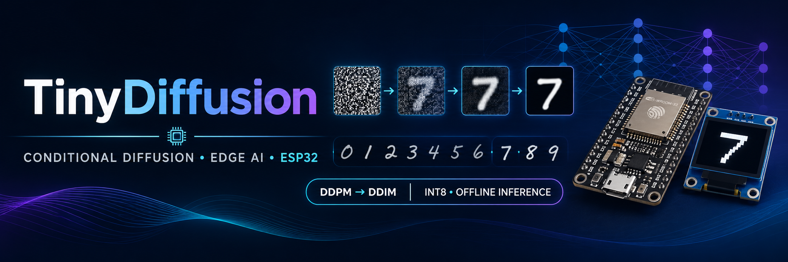

<div align="center">
  
</div>
# TinyDiffusion-ESP32

**A complete, modular, reproducible Edge AI project that trains a tiny conditional diffusion model on MNIST and runs image generation entirely offline on an ESP32 DevKit V1 (ESP32-WROOM-32) without external PSRAM.**

## Overview

This project implements a full ML pipeline from training to embedded deployment:

- **Model**: Tiny class-conditional CNN (~3,277 parameters) for noise prediction
- **Dataset**: MNIST (28×28 grayscale digits 0-9)
- **Training**: DDPM with linear noise schedule (100 timesteps)
- **Sampling**: DDIM with configurable steps (8, 16, 32)
- **Quantization**: Full INT8 for TensorFlow Lite Micro
- **Target**: ESP32 DevKit V1 (520 KB SRAM, no PSRAM)
- **Display**: SSD1306 OLED via U8g2 library
- **Framework**: Arduino + TensorFlow Lite Micro + ESP-NN

## Architecture

```
Input: 28×28×12 (noisy image + 10 class maps + 1 timestep map)
├── Conv2D: 8 filters, 3×3, SAME, ReLU
├── Conv2D: 8 filters, 3×3, SAME, ReLU
├── Conv2D: 12 filters, 3×3, SAME, ReLU
├── Conv2D: 8 filters, 3×3, SAME, ReLU
└── Conv2D: 1 filter, 3×3, SAME, Linear
Output: 28×28×1 (predicted noise)
```

### Conditioning Mechanism

The model receives concatenated input channels:
- Channel 0: Noisy image (1 channel)
- Channels 1-10: Class one-hot maps (10 channels, broadcast spatially)
- Channel 11: Normalized timestep map (1 channel, broadcast spatially)

### Diffusion Mathematics

**Forward Process (DDPM)**:
```
x_t = √(ᾱ_t) × x_0 + √(1 - ᾱ_t) × ε
```
where ᾱ_t = ∏_{s=1}^t (1 - β_s), β_s is the noise schedule.

**DDIM Sampling** (deterministic, η=0):
```
x_{t-1} = √(ᾱ_{t-1}) × x_0_pred + √(1 - ᾱ_{t-1}) × ε_pred
x_0_pred = (x_t - √(1 - ᾱ_t) × ε_pred) / √(ᾱ_t)
```

## Repository Structure

```
TinyDiffusion-ESP32/
├── README.md
├── requirements.txt
├── .gitignore
├── configs/
│   └── default.yaml          # Centralized configuration
├── notebooks/
│   └── TinyDiffusion_ESP32_Complete_Pipeline.ipynb  # Complete ML pipeline
├── src/
│   ├── dataset.py            # MNIST loading & preprocessing
│   ├── model.py              # Conditional CNN architecture
│   ├── diffusion.py          # Noise schedule & forward diffusion
│   ├── scheduler.py          # DDIM sampling implementation
│   ├── train.py              # Training pipeline
│   ├── evaluate.py           # Evaluation & visualization
│   ├── export.py             # TFLite export (float32 & INT8)
│   ├── quantize.py           # Quantization analysis
│   └── utils.py              # Shared utilities
├── scripts/
│   ├── download_dataset.py   # Download & inspect MNIST
│   ├── train.py              # Training entry point
│   ├── evaluate.py           # Evaluation entry point
│   ├── convert_model.py      # Model conversion entry point
│   ├── verify_tflite.py      # TFLite verification
│   └── generate_model_header.py  # C header generation
├── artifacts/                # Generated models, logs, results
├── esp32/
│   ├── platformio.ini        # PlatformIO configuration
│   ├── README.md             # Firmware documentation
│   ├── include/
│   │   ├── config.h          # Firmware configuration
│   │   ├── model_data.h      # Embedded model (auto-generated)
│   │   ├── diffusion.h       # DDIM sampling declarations
│   │   ├── oled.h            # Display interface
│   │   └── model_runner.h    # TFLite Micro runner
│   └── src/
│       ├── main.cpp          # Main firmware loop
│       ├── diffusion.cpp     # DDIM implementation
│       ├── oled.cpp          # Display implementation
│       ├── model_runner.cpp  # TFLite Micro inference
│       └── *.h               # Headers
└── tests/
    ├── test_model.py         # Model architecture tests
    ├── test_diffusion.py     # Diffusion process tests
    ├── test_scheduler.py     # DDIM scheduler tests
    ├── test_preprocessing.py # Preprocessing tests
    └── test_quantization.py  # Quantization tests
```

## Quick Start

### 1. Install Dependencies

```bash
python -m venv venv
source venv/bin/activate
pip install -r requirements.txt
```

### 2. Run the Complete Pipeline (Jupyter Notebook)

```bash
cd notebooks
jupyter notebook TinyDiffusion_ESP32_Complete_Pipeline.ipynb
```

Execute cells sequentially. **Training cells are marked with warnings** - only run when ready for long computation.

### 3. Or Use Command Line Scripts

```bash
# Download and inspect dataset
python scripts/download_dataset.py

# Train model (long running!)
python scripts/train.py --epochs 50 --batch-size 64

# Evaluate trained model
python scripts/evaluate.py --model artifacts/checkpoints/best_model.keras

# Convert to TFLite (float32 + INT8)
python scripts/convert_model.py --model artifacts/checkpoints/inference_model.keras

# Verify TFLite models
python scripts/verify_tflite.py

# Generate C header for ESP32
python scripts/generate_model_header.py
```

### 4. Build and Flash ESP32 Firmware

```bash
cd esp32
pio run              # Build
pio run --target upload  # Flash to device
pio device monitor   # Open serial monitor (115200 baud)
```

## Configuration

All hyperparameters and settings are centralized in `configs/default.yaml`:

- Model architecture (filter counts, layers)
- Diffusion schedule (linear/cosine, timesteps, beta range)
- Training (epochs, batch size, learning rate, LR schedule)
- Sampling (DDIM steps, eta)
- Quantization (INT8, calibration samples)
- ESP32 (tensor arena, display pins, serial baud)

Modify this file to experiment without changing code.

## Hardware Setup

### ESP32 DevKit V1 + SSD1306 OLED

| OLED Pin | ESP32 Pin |
|----------|-----------|
| VCC      | 3.3V      |
| GND      | GND       |
| SDA      | GPIO 21   |
| SCL      | GPIO 22   |

The display shows:
- Generated digit (28×28 scaled 2× to 56×56)
- Requested digit class
- Generation time
- DDIM step count
- Free heap memory

## Serial Commands

| Command | Description |
|---------|-------------|
| `G 7`   | Generate digit 7 |
| `R`     | Generate random digit |
| `STEPS 16` | Set DDIM steps to 16 |
| `ETA 0.5` | Set DDIM eta to 0.5 |
| `INFO`  | Show model & memory info |
| `HELP`  | Show command list |

## Performance

| Metric | Value |
|--------|-------|
| Model size (INT8) | ~12 KB |
| Tensor arena | 70 KB |
| Total RAM usage | ~93 KB |
| Flash usage | ~50 KB |
| 8-step generation | ~200-300 ms |
| 16-step generation | ~400-600 ms |
| 32-step generation | ~800-1200 ms |

## Known Limitations

1. **8-step DDIM quality**: May show artifacts; 16/32 steps recommended for better quality
2. **No PSRAM**: Tensor arena limited to ~70 KB internal SRAM
3. **ESP-NN acceleration**: Only for compatible operators (Conv2D benefits)
4. **Deterministic sampling**: Default eta=0 for reproducibility
5. **No Wi-Fi required**: Fully offline inference

## Reproducibility

- Fixed random seeds (Python, NumPy, TensorFlow)
- Deterministic TF operations enabled
- Identical math in Python and C++ implementations
- Quantization parameters embedded in model

## Testing

```bash
# Run all tests
pytest tests/ -v

# Run specific test file
pytest tests/test_model.py -v
pytest tests/test_diffusion.py -v
pytest tests/test_scheduler.py -v
```

## Mathematical Reference

### Noise Schedule (Linear)
```
β_t = β_start + (β_end - β_start) × t / (T - 1)
α_t = 1 - β_t
ᾱ_t = ∏_{s=1}^t α_s
```

### Forward Diffusion
```
q(x_t | x_0) = N(x_t; √(ᾱ_t)x_0, (1 - ᾱ_t)I)
```

### Training Objective
```
L = E[||ε - ε_θ(x_t, t, y)||²]
```

### DDIM Update (η=0)
```
x_{t-1} = √(ᾱ_{t-1}) × (x_t - √(1-ᾱ_t)ε_θ)/√(ᾱ_t) + √(1-ᾱ_{t-1}) × ε_θ
```

## License

MIT License - see LICENSE file for details.

## Citation

If you use this project in research, please cite:

```
@misc{tinydiffusion-esp32,
  title={TinyDiffusion-ESP32: Conditional Diffusion on Microcontrollers},
  author={...},
  year={2026}
}
```

## Contributing

1. Fork the repository
2. Create a feature branch
3. Make changes with tests
4. Submit a pull request

## Acknowledgments

- TensorFlow Lite Micro team
- ESP-NN optimization library
- U8g2 display library
- MNIST dataset (Yann LeCun)
- DDPM (Ho et al., 2020) and DDIM (Song et al., 2020) papers